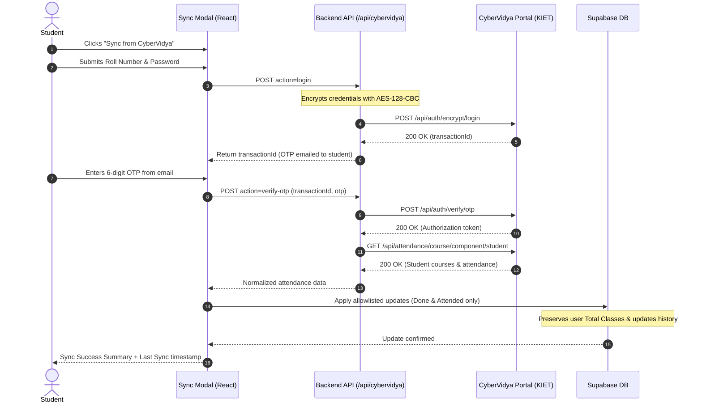

# Attendance Planner 🎓📊

A polished, production-quality shared attendance dashboard designed for college students. Features instant live sync via Supabase Realtime, optimistic updates with TanStack Query, what-if attendance projection simulation, detailed analytics charts with Recharts, and **optional CyberVidya attendance synchronization** for KIET students.

---

## 🌟 Key Features

1. **Open Collaboration**: No mandatory portal login or website passwords. Anyone with the URL can view and manage their personal dashboard.
2. **Optional CyberVidya Attendance Sync**:
   - Securely connect your KIET CyberVidya portal on-demand.
   - Enter your Roll Number & Password to request an official OTP sent to your student email.
   - Verify OTP and automatically synchronize subjects, Classes Done, and Classes Attended.
   - Independent session: CyberVidya is NOT the login system for the website.
3. **Deterministic Calculations & Pure Functions** ([`src/lib/plan.ts`](file:///c:/Users/prati/Documents/attendance/src/lib/plan.ts)):
   - Evaluates remaining classes ($R = \max(T - D, 0)$) and live attendance percentage.
   - Computes whole-semester required classes, needed classes, and skippable classes for both **86%** (recommended safe margin) and **75%** (statutory requirement).
   - Generates automated plain-language insights ranked by urgency (e.g. *“You must attend all 14 remaining classes...”*).
4. **Strict Total Classes Protection (Mandatory Guarantee)**:
   - **Total Classes** is planned and maintained manually by the student for whole-semester projections.
   - CyberVidya synchronization **never** overwrites, resets, or replaces Total Classes.
   - New imported subjects leave Total Classes unset (null) until manually configured.
   - Sync updates only an explicit allowlist of portal-owned fields: **Classes Done** and **Classes Attended**.
5. **Interactive "What-If" Simulator**:
   - Test skipping $N$ classes per subject or globally across all subjects to predict semester-end final percentages.
6. **Data Visualizations (Recharts)**:
   - Live attendance bars with 75% and 86% reference lines.
   - Stacked class breakdown (Attended / Missed / Remaining).
   - Skip budget comparisons across subjects.
   - Multi-subject historical trend line chart.
   - Radial attendance gauge.
7. **Realtime Live Sync**:
   - Subscribes to Postgres table changes (`entries`, `subjects`, `entry_history`, `cybervidya_sync`) and invalidates cache seamlessly in background.
   - Preserves user input focus and includes optimistic rollbacks on failure.
8. **Audit History & CSV Export**:
   - Drawer timeline tracking attendance changes over time.
   - 1-click CSV report export.

---

## 🔒 CyberVidya Synchronization Architecture



### Unofficial API Disclaimer
> [!NOTE]
> CyberVidya does not publish an official public developer API. The synchronization feature connects to the reverse-engineered student endpoints (`/api/auth/encrypt/login`, `/api/auth/verify/otp`, `/api/attendance/course/component/student`) used by the portal web and mobile clients. All portal interaction is isolated in dedicated modules (`src/server/cybervidyaService.ts` and `src/lib/cybervidya/sync.ts`).

---

## 🛡️ Security & Privacy Model

- **No Stored Passwords**: User CyberVidya passwords are encrypted in transit and are **never** stored in the database, local storage, session storage, or server logs.
- **No Stored OTPs or Secrets**: OTPs and JWT session tokens are never leaked into client logs.
- **CORS & Proxy Safety**: Requests to CyberVidya are mediated server-side via Vite dev middleware in local development and Vercel Serverless Functions in production (`/api/cybervidya`), preventing browser CORS restrictions.
- **Total Classes Protection**: Database updates strictly allowlist `done` and `attended`. `total_classes` is never overwritten by remote portal responses.
- **Private Synced Data**: Each student profile's sync state and subject mappings are tied specifically to their user record.
- **Safe Disconnect**: Disconnecting CyberVidya clears the connection metadata without deleting attendance records, resetting totals, or logging the user out.

---

## 🚀 Getting Started

### 1. Prerequisites
- Node.js (v18+)
- `pnpm` (or `npm`)

### 2. Environment Setup
Copy the example environment file:
```bash
cp .env.example .env.local
```

Populate the keys in `.env.local`:
```env
VITE_SUPABASE_URL=https://<your-project-ref>.supabase.co
VITE_SUPABASE_ANON_KEY=<your-anon-key>
```
*(Note: `.env*` files with secrets are ignored in `.gitignore`)*

### 3. Database Schema & Migration Setup
Execute the schema definitions in your Supabase SQL Editor:
1. **Base Schema**: Open [`supabase/schema.sql`](file:///c:/Users/prati/Documents/attendance/supabase/schema.sql) and run once.
2. **CyberVidya Migration**: Open [`supabase/migration_cybervidya.sql`](file:///c:/Users/prati/Documents/attendance/supabase/migration_cybervidya.sql) and run once to create:
   - `cybervidya_sync`: Stores last sync status, timestamp, and roll number per user.
   - `cybervidya_subject_mappings`: Maps external course/component IDs to local subject records to avoid duplicate generation.
   - `entries.total_classes`: Per-user planned semester total column.

### 4. Running Locally
```bash
# Install dependencies
pnpm install

# Start development server with built-in CyberVidya dev API
pnpm dev
```

### 5. Running Tests & Verification
```bash
# Run complete Vitest suite (95 tests covering plan calculations & CyberVidya sync)
pnpm test

# Build for production
pnpm build
```

---

## 🚢 Deploying to Vercel

1. Push your repository to GitHub / GitLab.
2. In the [Vercel Dashboard](https://vercel.com), select **Add New Project** and import the repository.
3. Configure the Project Settings:
   - **Framework Preset**: `Vite`
   - **Build Command**: `vite build`
   - **Output Directory**: `dist`
4. Add the Environment Variables:
   - `VITE_SUPABASE_URL`: Your Supabase Project URL
   - `VITE_SUPABASE_ANON_KEY`: Your Supabase Anon Key
5. Click **Deploy**. Vercel will build the frontend and deploy the `/api/cybervidya` serverless function automatically.
